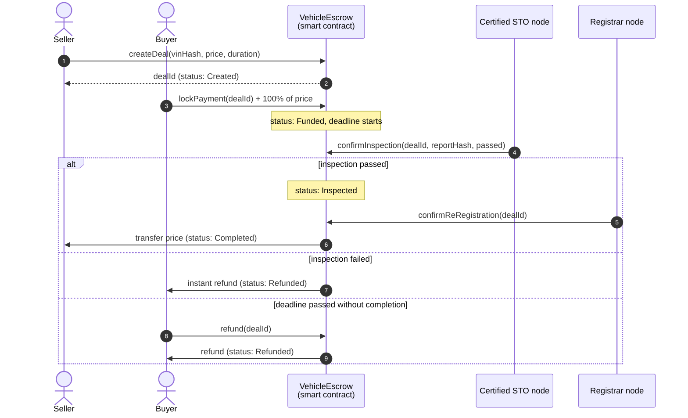
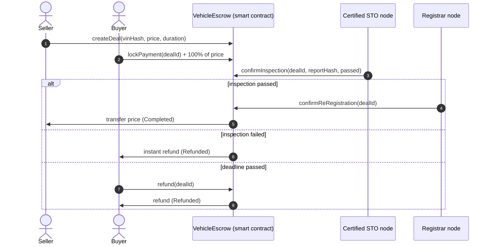

Educational project for the course Introduction to Finance. Not a real product, service or investment offer. Do not use with real funds.

# AutoTrustEscrow KZ: VehicleEscrow prototype

Final Project prototype (Introduction to Finance, Astana IT University, 2026-2027).
Startup idea: blockchain vehicle history registry and secure escrow for the used car market in Kazakhstan (invented startup, invented data).

- **Demo video (3 min):** https://drive.google.com/drive/folders/1brrKU96afk6m9z32Yc3nNPo7Y4OSya3a?usp=sharing
- **GitHub repository:** `<paste link here>`
- **Testnet contract address:** none (local Hardhat network only)

## What the prototype does

`VehicleEscrow` is one Solidity smart contract for the core use case: a used car sale where the buyer's money is held in escrow until the car passes a certified inspection (STO) and is re-registered.

1. Seller calls `createDeal(vinHash, price, duration)`.
2. Buyer calls `lockPayment(dealId)` and sends exactly 100% of the price.
3. A certified STO node calls `confirmInspection(dealId, reportHash, passed)`. If the car fails, the buyer is refunded instantly.
4. A registrar node calls `confirmReRegistration(dealId)`, and the contract pays the seller.
5. If the deadline passes without completion, anyone can call `refund(dealId)`; the money always goes to the buyer.

Only hashes (VIN hash, report hash), addresses and the price are stored on-chain. No personal data. All VINs, reports and amounts in tests and demo are invented, and the payment currency is the local chain's test currency.

### Roles and access rights

| Role | Who | Allowed |
| --- | --- | --- |
| `DEFAULT_ADMIN_ROLE` | platform admin (multisig in production) | grant/revoke roles, `pause`/`unpause`. **Cannot move funds.** |
| `STO_ROLE` | certified inspection stations | `confirmInspection` |
| `REGISTRAR_ROLE` | re-registration node | `confirmReRegistration` |
| Seller / Buyer | any address, per deal | `createDeal`, `cancelDeal` / `lockPayment` |

### Main use case (sequence diagram)





## How to run (local network only)

Requirements: Node.js 20 LTS (18 or 22 should also work) and npm.

```bash
npm install
npx hardhat compile
npm test            # runs 10 unit tests on the local Hardhat network
npm run demo        # step-by-step demo of the main use case (for the video)
```

Optional, to deploy on a persistent local node:

```bash
npx hardhat node                 # terminal 1: local chain with test accounts
npm run deploy:local             # terminal 2
```

No `.env` file, private key or seed phrase is needed. Never deploy to a main network and never connect this code to real funds.

## Tests

| # | Test | Checks |
| --- | --- | --- |
| 1 | happy path | create, lock, inspect, re-register, seller paid, contract balance 0 |
| 2 | wrong amount / seller buys own car | input validation |
| 3 | access control | only STO inspects, only registrar releases |
| 4 | failed inspection | instant refund to buyer |
| 5 | no release without inspection | state machine |
| 6 | refund after deadline | blocked before, allowed after, no double refund |
| 7 | expired deal | cannot be inspected |
| 8 | admin powers | admin can pause, cannot touch funds or the flow, refunds work while paused |
| 9 | cancel | only seller, only before funding |
| 10 | reentrancy attack | malicious buyer contract cannot re-enter `refund` |

## Security notes

- **Reentrancy:** checks-effects-interactions plus OpenZeppelin `ReentrancyGuard` (test 10).
- **Broken access control:** OpenZeppelin `AccessControl`, separate roles, admin has no fund-moving function (tests 3, 8).
- **Key loss/theft:** admin key should be a multisignature wallet in production (not part of this prototype).
- Not audited. An external audit is planned in the budget of the project report.

## Project structure

```
contracts/VehicleEscrow.sol        main contract
contracts/mocks/MaliciousBuyer.sol test helper for the reentrancy test
test/VehicleEscrow.test.js         10 unit tests
scripts/demo.js, scripts/deploy.js demo for the video, local deploy
docs/sequence-diagram.(mmd|png)    Figure 1
```

## Credits and AI disclosure

- Open-source code: [OpenZeppelin Contracts](https://github.com/OpenZeppelin/openzeppelin-contracts) 5.x (MIT licence): `AccessControl`, `ReentrancyGuard`, `Pausable`.
- Tools: Hardhat (MIT).
- AI: `<name every AI tool and exact model and what it was used for, e.g. "Claude (model name): drafted the first version of the contract and tests, reviewed and changed by the team">`

## Team
Aibergen Amanzhol — Group SE-2538 — Team Lead, Legal & Regulatory Compliance, Pitch (@<aibergen74-create>)

Zhanassyl Omar — Group SE-2538 — Business Model, Market Sizing & Risk Matrix (@<Zhanasyl08>)

Abay Tleugalyyev — Group SE-2538 — CTO, Smart Contract Prototype & Hardhat Test Suite (@<Windze>)

Adilzhan Tolegen — Group SE-2538 — CFO, 3-Year Financial Plan, DCF/NPV & Sensitivity Analysis (@<realadikaah>)
