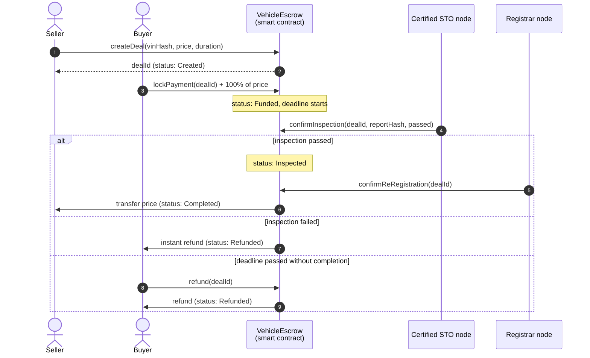

Educational project for the course Introduction to Finance. Not a real product, service or investment offer. Do not use with real funds.

# AutoTrustEscrow KZ: VehicleEscrow prototype

Final Project prototype (Introduction to Finance, Astana IT University, 2026-2027).
Startup idea: blockchain vehicle history registry and secure escrow for the used car market in Kazakhstan (invented startup, invented data).

- **Demo video (3 min):** https://drive.google.com/drive/folders/1brrKU96afk6m9z32Yc3nNPo7Y4OSya3a?usp=sharing
- **GitHub repository:** `<paste link here>`
- **Testnet contract address:** none (local Hardhat network only)

## What the prototype does

`VehicleEscrow` is one Solidity smart contract for the core use case: a used car sale where the buyer's money is held in escrow until the car passes a certified inspection (STO) and is re-registered.

1. Seller calls `createDeal(vinHash, price, duration)`.
2. Buyer calls `lockPayment(dealId)` and sends exactly 100% of the price.
3. A certified STO node calls `confirmInspection(dealId, reportHash, passed)`. If the car fails, the buyer is refunded instantly.
4. A registrar node calls `confirmReRegistration(dealId)`, and the contract pays the seller.
5. If the deadline passes without completion, anyone can call `refund(dealId)`; the money always goes to the buyer.

Only hashes (VIN hash, report hash), addresses and the price are stored on-chain. No personal data. All VINs, reports and amounts in tests and demo are invented, and the payment currency is the local chain's test currency.

### Roles and access rights

| Role | Who | Allowed |
| --- | --- | --- |
| `DEFAULT_ADMIN_ROLE` | platform admin (multisig in production) | grant/revoke roles, `pause`/`unpause`. **Cannot move funds.** |
| `STO_ROLE` | certified inspection stations | `confirmInspection` |
| `REGISTRAR_ROLE` | re-registration node | `confirmReRegistration` |
| Seller / Buyer | any address, per deal | `createDeal`, `cancelDeal` / `lockPayment` |

### Main use case (sequence diagram)



```mermaid
sequenceDiagram
    autonumber
    actor Seller
    actor Buyer
    participant C as VehicleEscrow (smart contract)
    participant STO as Certified STO node
    participant Reg as Registrar node
    Seller->>C: createDeal(vinHash, price, duration)
    Buyer->>C: lockPayment(dealId) + 100% of price
    STO->>C: confirmInspection(dealId, reportHash, passed)
    alt inspection passed
        Reg->>C: confirmReRegistration(dealId)
        C->>Seller: transfer price (Completed)
    else inspection failed
        C->>Buyer: instant refund (Refunded)
    else deadline passed
        Buyer->>C: refund(dealId)
        C->>Buyer: refund (Refunded)
    end
